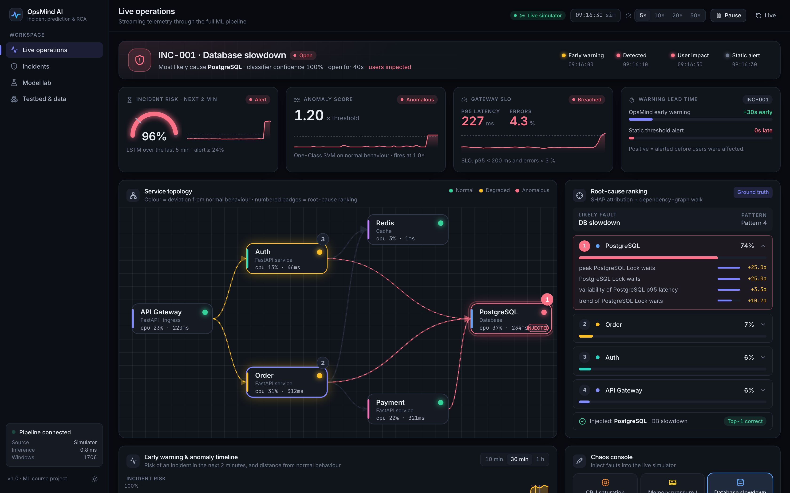

# OpsMind AI

**A Machine Learning Framework for Incident Prediction and Root-Cause Analysis in Microservice Systems**

An end-to-end AIOps project for proactive incident detection, forecasting, and root-cause analysis.

[](#quick-start)
[](#dashboard)
[](#api)
[](LICENSE)



OpsMind detects abnormal behaviour in a running microservice system, warns a few minutes *before* users are affected, and ranks the components most likely responsible — with a live React dashboard on top.

> A full visual walkthrough—including the live dashboard, Model Lab, Docker testbed, and API—is available in [docs/SYSTEM_WALKTHROUGH_AND_RESULTS.md](docs/SYSTEM_WALKTHROUGH_AND_RESULTS.md). The screenshot gallery is stored in [docs/screenshots/](docs/screenshots/).

```
testbed (Docker) ─┐
                  ├─► telemetry ─► preprocessing ─► anomaly detection ─┐
simulator ────────┘   (5 s)        (30 s windows,    classification     ├─► root-cause ─► FastAPI ─► React
 (same schema)                      Drain logs)      clustering         │   (SHAP + graph)
                                                     early-warning LSTM ┘
```

## Quick start

```bash
python3 -m venv .venv && .venv/bin/pip install -r requirements.txt   # macOS: brew install libomp (XGBoost)
make all          # dataset → train → build dashboard → serve on http://localhost:8000
```

Individual steps: `make dataset` · `make train` · `make loghub` · `make dashboard` · `make api` · `make test`.
Dashboard dev server with hot reload: `make api` in one terminal, `cd dashboard && npm run dev` in another (http://localhost:5173).

## Important: what ran where

| Piece | Status |
|---|---|
| ML pipeline, API, dashboard, tests | **Built and run end to end** on this machine. |
| Dataset | Generated by a **simulator** of the testbed (`opsmind/sim/`): 254 thirty-minute runs, 210 fault episodes, 22 h of normal operation, 45 k labelled windows, 579 k log lines. |
| Docker testbed (`testbed/`) | **Built and run on real Docker** (Docker Desktop, macOS): all 10 containers healthy, real traffic through gateway → auth/order → payment → Postgres/Redis, every one of the 6 fault injectors smoke-tested, all 43 metrics queryable from Prometheus. Fixing the first real run exposed bugs the simulator could never show (startup race, cAdvisor blind on Docker Desktop, PromQL gaps, Pumba CLI limits, DB exporter dropping out during slowdowns). Two real campaigns (96 runs) are used to train and evaluate on real data — see *Real testbed campaigns* below. |
| Loghub HDFS validation | Run on the public 2k labelled sample: Drain grouping accuracy **99.75 %** (the full 11 M-line dataset was not used). |

## Results (held-out test runs, simulator data)

Split: chronological per fault type, always by whole experiment run — 60 % train / 15 % val / 25 % test. Test set = **54 unseen fault episodes** (43 breached the user SLO) — small, so treat differences of one or two episodes as noise.

| Module | Result | Baseline |
|---|---|---|
| **Anomaly detection** (trained on normal only, alert budget ≤ 0.5 false alarms/h) | One-Class SVM **F1 0.852**, 0.16 false alarms/h · PCA-reconstruction F1 0.825 · Isolation Forest (on PCA) F1 0.600 | Static thresholds F1 0.742, 0.61 false alarms/h |
| **Classification** (6 fault types, macro-F1) | Stacking **0.979** · Logistic Regression 0.977 · Random Forest 0.974 · XGBoost 0.968 | Majority class 0.047 |
| **Detector + classifier** | classifier vetoes benign anomalies: false alarms 0.16/h → 0.00/h, F1 0.853 | detector alone F1 0.852 |
| **Clustering** (no labels) | K-means ARI **0.667** (k=12) · Ward 0.647 · DBSCAN 0.549 | Random assignment ARI ≈ 0 |
| **Early warning** (impact within 2 min) | LSTM warns before user impact in **19/43** episodes (recall 0.44, mean lead **107 s**, 0.36 false alarms/h); GB 20/43; GRU 18/43 | Static alerts: 9/43 early, 30 *late* |
| **Root-cause ranking** (episode level) | SHAP + dependency graph: **top-1 94 %, top-3 100 %** | Highest raw CPU: top-1 31 %, top-3 57 % |

### Honest reading of the numbers

* **Early warning is limited by physics, not just modelling.** Crashes and cache outages have no precursor, and CPU-saturation ramps look like healthy traffic surges (the LSTM warns on 0 % of them). Gradual faults (database 100 %, network 86 %, memory 75 %) are where the lead time comes from. Per-fault recall is shown in the Model Lab rather than hidden in an average.
* **Isolation Forest loses** to One-Class SVM and PCA reconstruction here — it scores each window in isolation and, on all 299 features, collapsed under the alert budget (F1 0.10) until it was run on PCA features.
* **Classification is close to saturated** (all good models 0.97–0.98): simulated fault signatures are cleaner than real ones, so single-vs-ensemble differences are small. Real telemetry will be harder.
* **Root-cause:** the plain "largest z-score" ablation reaches 93 % top-1, so SHAP + graph adds ~2 episodes over it — the larger win is over the raw-metric baseline.
* All metrics are single-seed on one split.

## Architecture

```
opsmind/
  config.py        components, metrics, call graph, windowing, fault catalogue (single source of truth)
  sim/             stateful testbed simulator: queueing latency, error propagation, timeouts, cache fallback,
                   6 fault types with ramps, benign spikes/backups/blips, structured log emission
  dataset.py       campaign → labelled feature table (labels only from the injector log)
  logs.py          Drain parsing + (service, template) count features
  features.py      cleaning, 30 s windows, rolling stats, NormalScaler, sequence index
  models/          dimred · anomaly · classify (single + ensembles) · cluster · earlywarning (+ ew_worker) · rootcause
  evaluate.py      window metrics; alert/lead-time scoring; false alarms per hour
  pipeline.py      trains and evaluates all 8 modules → artifacts/
  runtime.py       online per-window inference, incident lifecycle (open/resolve, lead time vs static alerts)
  sources.py       live simulator source (fault injection) and replay source
api/               FastAPI: REST + WebSocket stream, fault injection, scenarios, replay, /api/predict
dashboard/         React + TypeScript + Tailwind + Recharts
testbed/           Docker Compose app, Prometheus, Locust, fault injector, collector (run and verified on Docker Desktop)
tests/             train/serve feature parity, end-to-end detection + RCA, alert-scoring logic
```

### ML modules

| # | Module | Techniques |
|---|---|---|
| 1 | Preprocessing | forward-fill of missed scrapes, 30 s windows (mean/std/min/max/Δ), Drain log templates |
| 2 | Dimensionality reduction | PCA vs Gaussian random projection (downstream F1, reconstruction error), 2-D state map |
| 3 | Anomaly detection | Isolation Forest, One-Class SVM, PCA reconstruction vs static thresholds |
| 4 | Classification | Logistic regression, KNN, Naive Bayes, decision tree, SVM |
| 5 | Ensembles | Random forest, XGBoost, soft voting, stacking (run-grouped CV) |
| 6 | Clustering | K-means, Ward, DBSCAN; silhouette, ARI, NMI vs true faults |
| 7 | Early warning | LSTM/GRU on the last 5 min, Platt-calibrated, vs gradient boosting and thresholds |
| 8 | Root cause | SHAP on the classifier → per-component mass → dependency-graph walk |

### Design decisions worth knowing

* **Alert budget.** Detector thresholds maximise F1 *subject to* ≤ 0.5 sustained false alarms/hour on validation; early-warning thresholds subject to ≤ 1/h. Without a budget an F1-tuned threshold hides false-alarm cost.
* **Impact, not fault start, defines "incident".** The user-facing SLO (gateway p95 > 200 ms or errors > 3 %) sets the impact time; lead time = impact − first alert. Faults that never breach the SLO are *silent* and excluded from early-warning scoring (they still count for detection).
* **Benign anomalies are labelled normal on purpose:** traffic spikes, nightly-backup page-cache memory and noisy-neighbour CPU blips — the cases where static thresholds raise false alarms.
* **Train/serve parity is tested** (`tests/test_runtime.py` replays a run through the online path and compares with the offline feature table).
* **PyTorch and XGBoost cannot share one process on macOS** (conflicting OpenMP runtimes → crash/deadlock). The LSTM trains in a worker process (`ew_worker.py`) and is served by a ~40-line NumPy forward pass — no torch in the serving path.
* "Upstream" in root-cause ranking prioritises components that others *depend on* (providers) among anomalous services, because failures spread to their callers.

## Dashboard

* **Live operations** — status banner with the incident lifecycle (early warning → detected → user impact → static alert), risk gauge, anomaly score, SLO, warning lead time vs static alerts, animated service topology with root-cause badges, SHAP drivers, metric explorer with fault bands and alert markers, chaos console (inject any fault, healthy traffic burst, scripted scenarios), event feed, Drain-parsed log stream, failure-pattern assignment.
* **Incidents** — session incident log and every held-out test episode with OpsMind vs static-alert lead time; **Replay** streams any of them through the live pipeline.
* **Model lab** — every module vs its baseline: success-criteria scorecard, PCA map, PR curves, confusion matrices, clustering map and pattern cards, lead-time histogram, root-cause ablation.
* **Testbed & data** — architecture, fault catalogue, dataset statistics, Loghub result, Drain templates.

Shortcuts: `g l` / `g i` / `g m` / `g t`. Light and dark themes.

## API

| Endpoint | Purpose |
|---|---|
| `GET /api/config`, `/api/status`, `/api/health` | topology, fault catalogue, session state |
| `WS /ws/live` | snapshot + one tick per 10 simulated seconds (all model outputs) |
| `POST /api/faults/inject`, `/spike`, `/clear`, `/api/scenarios/run` | chaos console |
| `POST /api/session/control`, `/speed`, `/replay` | pause/resume/reset, 5×–50× speed, replay a test run |
| `POST /api/predict` | stateless: score ≥ 6 raw scrapes with the full pipeline |
| `GET /api/benchmarks`, `/api/dataset`, `/api/replay/runs` | Model Lab data |

Interactive docs at `/docs`. Inference costs ≈ 3–5 ms per window.

## Real testbed campaigns (Docker, executed)

```bash
make real-up        # build + start the 10-container stack (+ Locust load)
make real-medium    # campaign 1 (≈ 8 h): abrupt faults, 9 min runs
make real-ramped    # campaign 2 (≈ 9 h): gradual faults, 12 min runs, stack reset before every run
make real-collect   # / real-collect2: Prometheus metrics + Docker logs -> data/real{,2}/ (same schema as the simulator)
make real-train     # merge the campaigns, train every module on real runs, compare with the simulator models
```

Two overnight campaigns on this machine, 96 real runs in total, labels only from the real injector log:

| | Campaign 1 | Campaign 2 |
|---|---|---|
| Runs | 54 × 9 min (48 fault episodes, 6 healthy) | 42 × 12 min (37 fault episodes, 5 healthy) |
| Faults | abrupt (instant lock, kill, delay) | **gradual**: network delay and loss ramp, DB heavy queries ending in a lock, crash-loop prelude, stepped CPU |
| Healthy burst | 4× (240 users) — overloads the gateway | 3× (170 users) — stays within the SLO |
| Stack state | long-lived services | **restarted and health-checked before every run** |
| Episodes reaching users | 20 | 25 (all DB, network and crash episodes) |

Whole runs are split chronologically *within each campaign and fault type* (55 train / 18 validation / 23 test runs; 5,745 windows). Everything below is scored on the **23 held-out real runs (21 fault episodes, 9 of which reached users)** — still a small sample, so expect noise.

| Held-out real runs | Static thresholds | Simulator-trained (zero-shot) | **Trained on real data** |
|---|---|---|---|
| Detection F1 | 0.731 | 0.644 | **0.979** (PCA reconstruction) |
| Precision / recall | 1.00 / 0.58 | 0.47 / 1.00 | 0.98 / 0.98 |
| Fault episodes detected | 15 / 21 | 21 / 21 | 21 / 21 (mean delay 30 s) |
| False alarms / hour | 0.0 | 0.65 | 1.3 (0.65 with the classifier as a filter, F1 0.972) |
| Warned before user impact (9 episodes) | 3 / 9, mean lead 42 s, 6 late | 0 / 9 | **3 / 9, mean lead 102 s**, 0 false alarms |
| – of which DB slowdown | 2 / 2, lead 58 s | — | **2 / 2, lead 148 s** |
| – network latency / service crash | 1 / 3, 0 / 4 | — | 1 / 3, 0 / 4 |
| Fault-type macro-F1 | — | — | 0.923 (XGBoost) |
| Root cause top-1 / top-3 | 24 % / 57 % (raw CPU) | — | **95 % / 100 %** (SHAP + dependency graph) |

**Overload and bad starts are excluded.** 73 of 5,745 windows (1.3 %) breach the user SLO while *no fault is injected*: 52 come from the 4× burst of campaign 1 overloading the single-CPU gateway (p95 640–830 ms at 245–283 req/s), 21 from one run that started with a stale, degraded gateway. They are neither healthy nor injected faults, so they are excluded from training and scoring, and alerts firing during them are not counted as false alarms. (Counting them had produced a spurious ≈ 7 false alarms/hour for every method.)

Honest reading:

* **The simulator does not transfer as-is** — zero-shot, it detects every fault but flags many healthy windows (precision 0.47). **Training on real runs fixes that**: F1 0.64 → 0.98, and the faulty component is first in 95 % of episodes.
* **Early warning now works on real data — for gradual faults only.** The LSTM warns for both held-out database cascades (heavy queries, then a lock) with a mean lead of 148 s, 2.6× earlier than static alerts. It does **not** help for fast faults: network degradation reaches users 22–45 s after onset and a crash-loop hurts users at its first restart, so there is little or nothing to warn about. Overall it warns for 3 of 9 impacting episodes, the same count as static alerts but with 2.4× the lead time. CPU saturation, memory leaks and cache failures never reached users on this stack (*silent* faults).
* **The detection result needs caution.** There is no leakage (whole runs are split; scaler and detector are fit on training healthy windows only), but the test set is small and the faults large (intensity ≥ 0.4). On real data only PCA reconstruction is a good detector; One-Class SVM and Isolation Forest score F1 0.10–0.45 here, the reverse of their simulator ranking.
* **False alarms are low but barely measured**: 1.3/hour is 2 alerts over about 1.5 healthy hours.
* **Classification** is 0.92 on real data against 0.98 in simulation; K-means clustering still recovers real failure patterns (ARI 0.66).
* **A hypothesis that did not pan out:** load-normalised features (CPU per request, callee/caller throughput ratios) left detection and early warning unchanged; the code is kept as an optional block (`load_norm`).

Operational lessons: long-lived services degrade after injected faults (a gateway whose upstream calls all time out until restarted), so campaign 2 resets and health-checks the stack before every run; one test run of campaign 1 started in that state. The collector trims runs at monitoring gaps (a sleeping laptop once cost 312 of 468 samples; campaigns run under `caffeinate`); the SLO-impact finder credits a breach to a fault only if it *begins* after fault start; `docker` is not on the default PATH on Docker Desktop for macOS (the Makefile adds it); the real network fault uses `tc netem` directly (Pumba's CLI cannot combine delay and loss). The dashboard's Model lab has a **Simulator data / Real Docker data** switch, and replaying a real run uses the real-trained models.

## Limitations & future scope

Headline benchmarks are on simulated data (see the real-testbed campaigns for the measured gap; the real evaluation has 23 held-out runs), root cause is component-level (not causal), single seed, no automatic remediation. Future scope includes an RL remediation agent, OpenTelemetry tracing, Kubernetes, and a larger benchmark app.

## References

Liu et al., *Isolation Forest* (ICDM 2008) · Du et al., *DeepLog* (CCS 2017) · He et al., *Drain* (ICWS 2017) · Zhu et al., *Loghub* (ISSRE 2023) · Lundberg & Lee, *SHAP* (NeurIPS 2017) · Chen & Guestrin, *XGBoost* (KDD 2016) · Hochreiter & Schmidhuber, *LSTM* (1997). Verify citation details before submission.
